# AURORA · Mission Lab & Live Events

[](https://github.com/sripadsirik/Aurora_Space/actions/workflows/engineering.yml)
[](https://github.com/sripadsirik/Aurora_Space/actions/workflows/deploy-pages.yml)

Aurora puts satellites, aircraft, launch pads, road cameras, and Formula 1 cars on one interactive Earth. Select an object to follow it or inspect its data. In Mission Lab, investigate a close approach between two spacecraft and compare the burns that could separate them.

**[Open Aurora](https://sripadsirik.github.io/Aurora_Space/)** · **[Explore road cameras](https://sripadsirik.github.io/Aurora_Space/?cameras=hong-kong)** · **[Replay F1 on Earth](https://sripadsirik.github.io/Aurora_Space/?events=earth)** · **[Try Mission Lab](https://sripadsirik.github.io/Aurora_Space/?mission=1)**

## Satellites, planes and rockets

| Satellite · Hubble Space Telescope | Plane · Douglas DC-8 | Rocket · Space Launch System |
| --- | --- | --- |
| [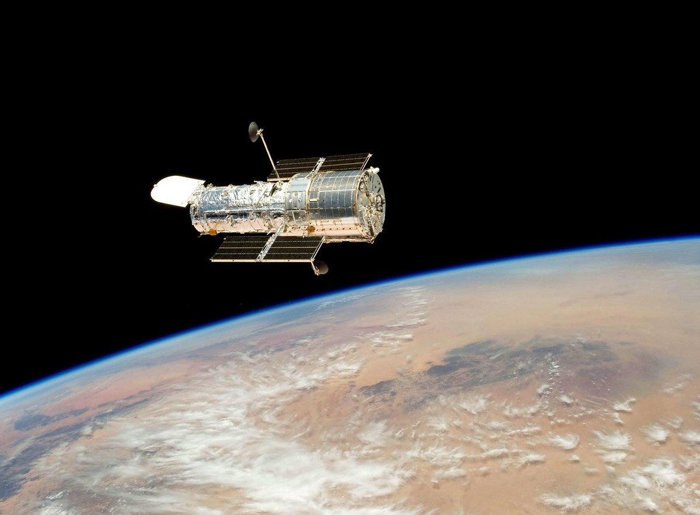](docs/images/hubble-in-orbit.jpg) | [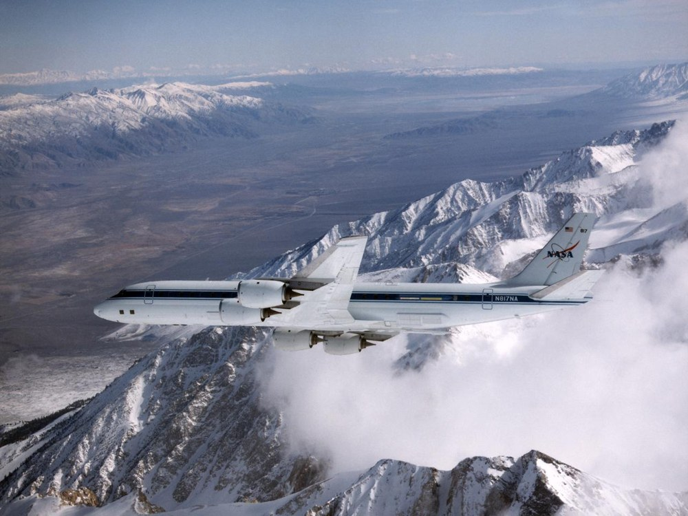](docs/images/dc8-in-flight.jpg) | [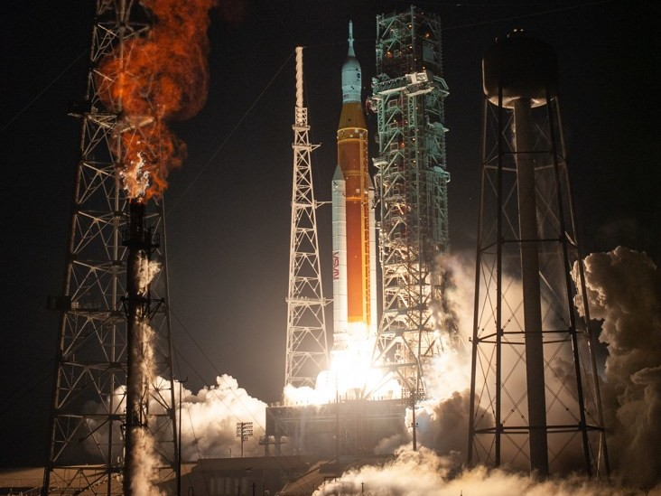](docs/images/artemis-i-launch.jpg) |
| Photographed from Atlantis after Hubble’s final servicing mission in 2009. [NASA](https://science.nasa.gov/asset/hubble/hubbles-final-release-over-earth-2009/) | NASA’s airborne laboratory over California in 1998. [NASA / Jim Ross](https://images.nasa.gov/details/EC98-44444-004) | Artemis I leaving Pad 39B in 2022. [NASA / Kevin Davis and Chris Coleman](https://www.nasa.gov/image-article/one-year-ago-artemis-i-lifts-off/) |

### The views inside Aurora

| Following Hubble | Following flight SWA1125 | Simulated liftoff at Kennedy |
| --- | --- | --- |
| [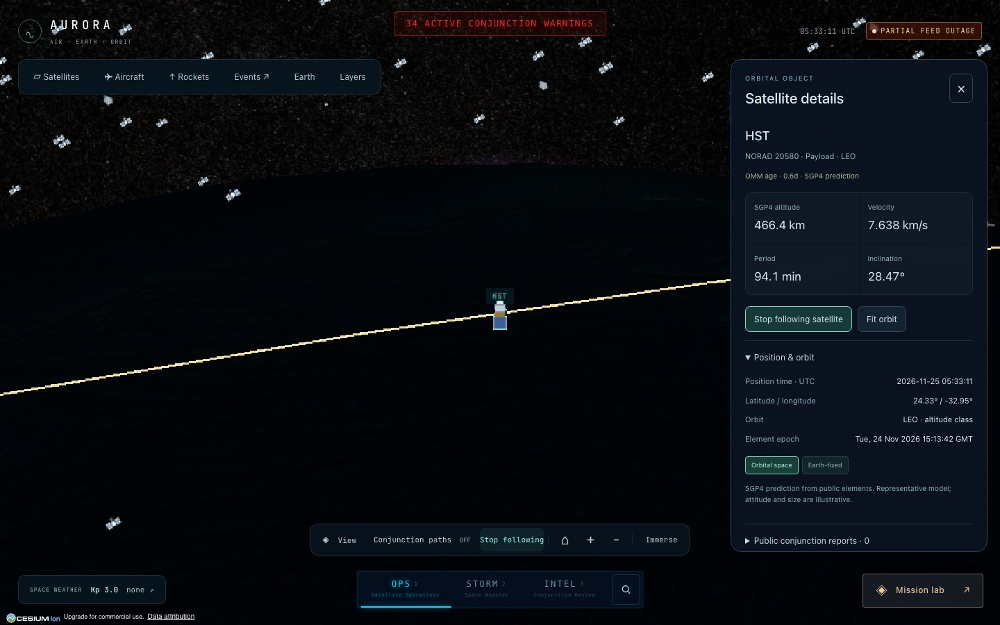](docs/images/hubble-follow.jpg) | [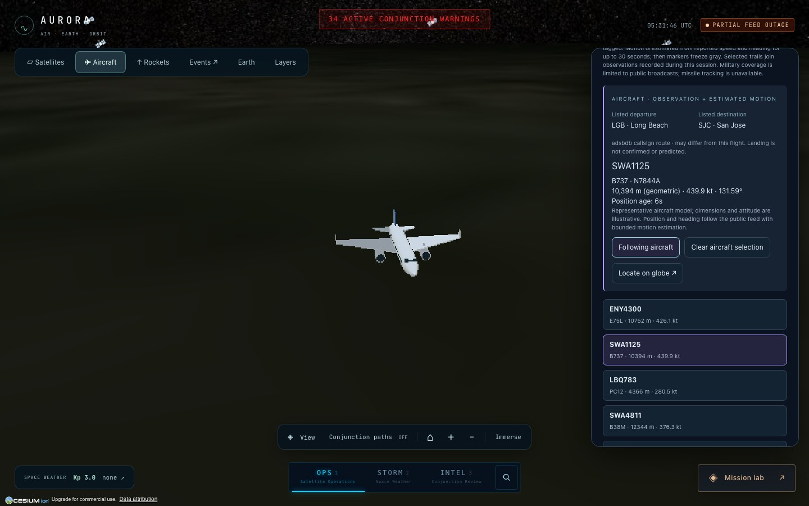](docs/images/aircraft-follow.jpg) | [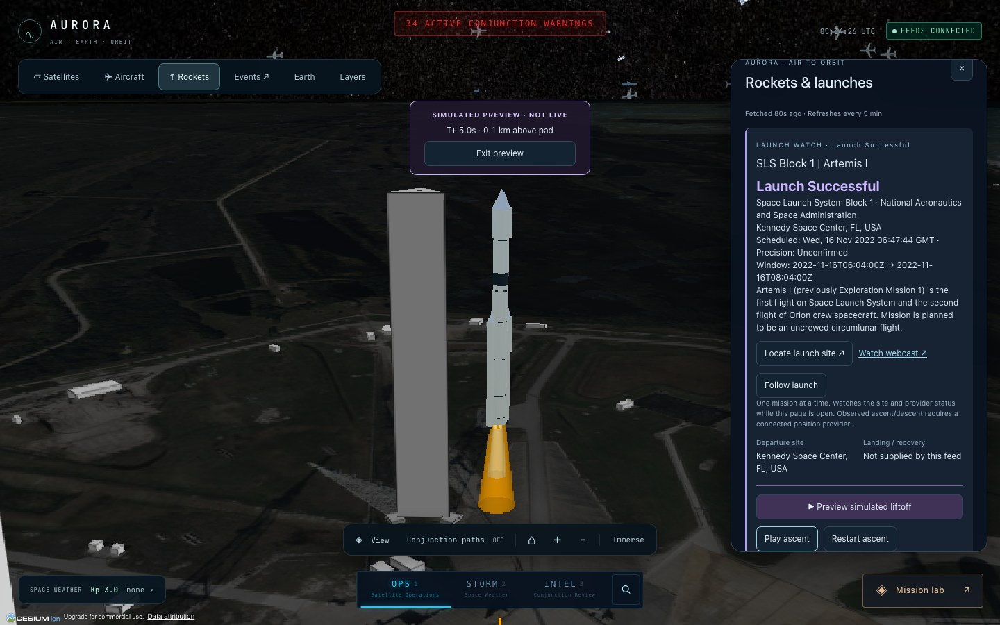](docs/images/rocket-liftoff-preview.jpg) |

- **Satellites.** Select an object by name or NORAD ID. Inspect its altitude, speed, inclination and element epoch. **Fit orbit** frames the predicted trajectory and **Follow satellite** keeps the object in view. The live stack propagates CelesTrak orbital elements with SGP4. The feed badge shows when the catalog was received. [O3b mPOWER inspector](docs/images/satellite-inspector.jpg)
- **Aircraft.** Open **Aircraft → Worldwide** for recent OpenSky observations, or choose a regional adsb.lol feed. Select a flight and choose **Follow aircraft**. Movement between reports uses the last reported speed and heading for up to 30 seconds. Tracks disappear after 90 seconds without a fresh position. Coverage depends on receivers and provider quotas.
- **Rockets.** Select a mission in **Rockets** to see the launch window, pad, countdown, status and webcast when supplied by Launch Library 2. **Follow launch** watches the pad and mission status. **Preview simulated liftoff** flies an illustrative three-minute ascent. Observed flight paths require a configured source of mission-matched positions. [Rocket telemetry guide](docs/rocket-telemetry.md)

The launch preview above uses the archived Artemis I mission record. Here is the countdown view for a different mission, Long March 2C at Xichang, captured before its launch window.

[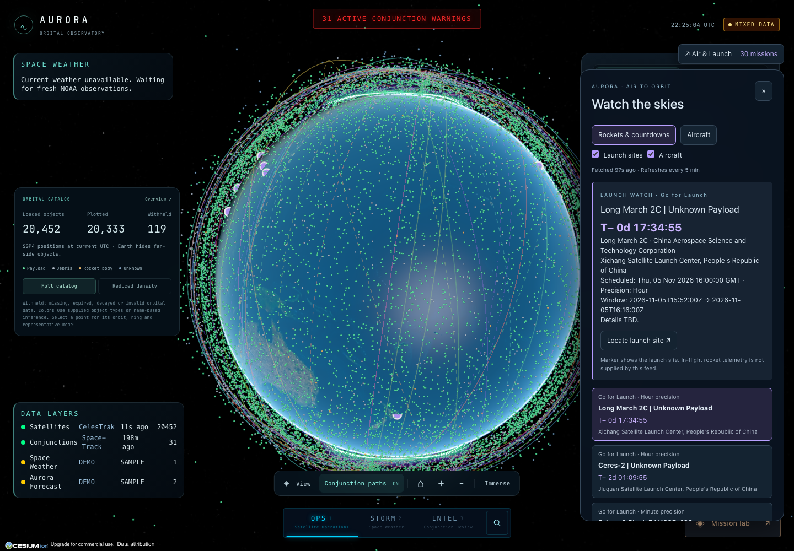](docs/generated/aerospace/live-launches.png)

## Explore Earth and orbit

| Road cameras | Places |
| --- | --- |
| [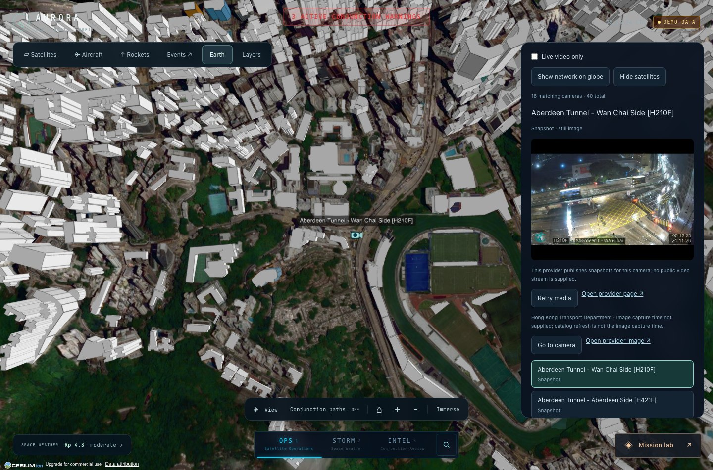](docs/images/earth-road-camera.jpg) | [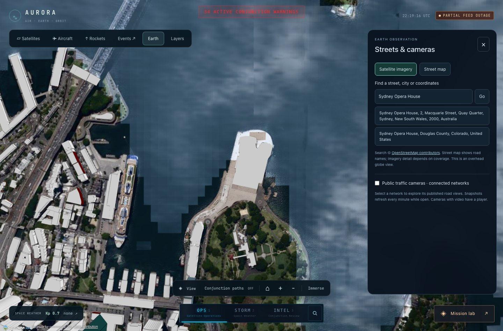](docs/images/earth-place-search.jpg) |
| Open **Earth → Camera network** and select a marker to see the publisher’s snapshot or stream. | Search by street, city or landmark with the live gateway. Enter latitude and longitude in either mode. |

The public demo includes 53 road-camera locations across Hong Kong, British Columbia, California, London, Finland and New Zealand, plus two Chicago skyline streams. The gateway retrieves current agency catalogs and adds Illinois road networks, Singapore and New South Wales. Snapshot timing and video availability depend on the publisher. [Camera coverage and credits](docs/camera-coverage.md)

## Formula 1 Events

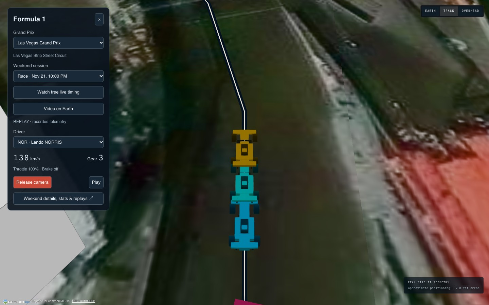

Open **Events → Weekend details, stats & replays**. Choose **Upcoming** for the next race and countdown, or **Full season** for all rounds. The year selector includes the previous, current and next calendar years. Each published weekend lists practice, sprint sessions where scheduled, qualifying and the Grand Prix in local time or UTC. Next-year events appear when the calendar provider publishes them. [Open the calendar](https://sripadsirik.github.io/Aurora_Space/?events=1)

| Mode | What appears on Earth |
| --- | --- |
| Free live timing | Open the race and select **Watch free live timing**. Each car starts moving after its first fresh sector crossing. Positions between crossings are estimated from official timing. Select **Follow car** for a chase view. |
| Historical replay | Select a completed session and choose **Watch real replay**. Scrub recorded positions, speed, gear, throttle and brake alongside the timing tower. Channels depend on the session. |
| Measured live telemetry | The local gateway can use a subscriber’s OpenF1 access token to retrieve buffered position and car telemetry during a session. |
| Video on Earth | Open a local recording, embeddable YouTube video or compatible HTTPS stream beside the globe. Broadcast access depends on the rights holder. The player and telemetry have independent clocks. |

The calendar uses Jolpica. Historical position and telemetry samples come from OpenF1. The race detail view includes session results, qualifying times and running order where available. [Race telemetry screenshot](docs/images/f1-race-telemetry.png) · [Weekend video screenshot](docs/images/f1-weekend-video.jpg) · [F1 sources and replay guide](docs/f1-events.md)

## Mission Lab

Start with the bundled **85-metre encounter**. Inspect the closest approach, compare eleven maneuver candidates and their propellant costs, then export the engineering report and replay archive. The encounter is synthetic and runs in the browser without credentials. [Mission Lab walkthrough](docs/mission-lab.md) · [Recorded demonstration](docs/generated/demo/video.webm) · [Example engineering report](docs/generated/example-engineering-report.md)

[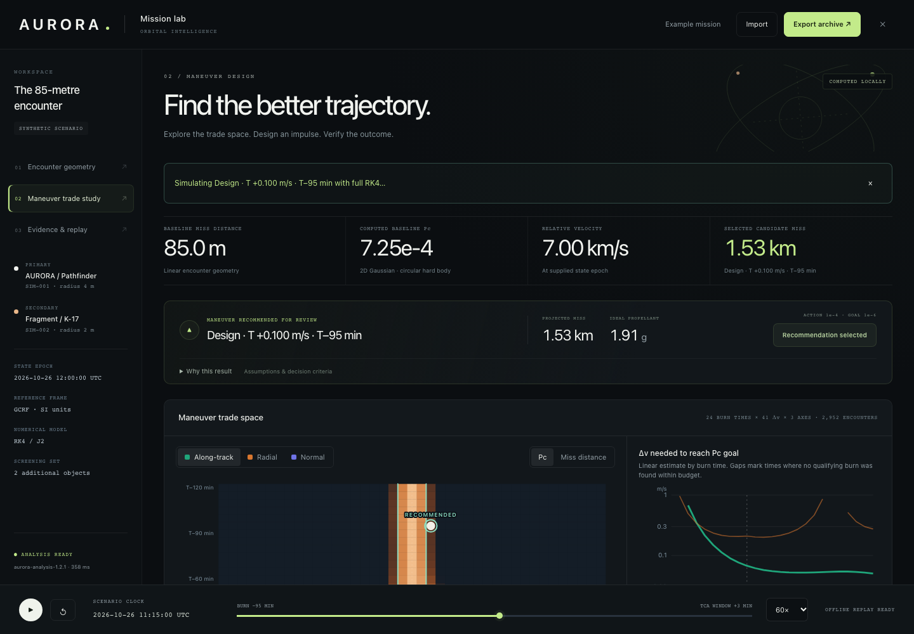](docs/generated/demo/trade-space-desktop.png)

## Start everything in one terminal

### Browser demo

Open the hosted app or run the same frontend locally with Git and **Node.js 22.12 or later**. The launcher installs frontend dependencies. [Hosted demo](https://sripadsirik.github.io/Aurora_Space/)

```sh
git clone https://github.com/sripadsirik/Aurora_Space.git
cd Aurora_Space
npm run demo
```

Open [localhost:5173](http://localhost:5173). Mission Lab and the sample orbital catalog run locally. Camera images, calendar updates and historical F1 telemetry need network access to their publishers.

### Run with live public data

Install **Go 1.21 or later** and **Docker with Compose** in addition to Node.js. Start Docker, then run this from the repository root.

```sh
npm start
```

The launcher starts Kafka, monitoring, the Go ingestion services, the orbital engine, the WebSocket gateway and the frontend. Use this mode for live orbital elements, aircraft observations, launch schedules and street-name search. Open the feed-status badge for provider names, timestamps and record counts.

| Command | Purpose |
| --- | --- |
| `npm run status` | Show the active session and its dashboard, health and monitoring URLs. |
| `npm stop` or **Ctrl+C** | Stop the session and the containers it started. |
| `npm start -- --engine=rust` | Select the optional Rust orbital engine. It requires Cargo, CMake, a C/C++ toolchain and the native librdkafka build dependencies. |

The default frontend port is 5173 and the gateway uses 8080. Set `AURORA_PORT` to change the frontend port. The launcher prints the assigned Grafana and Prometheus URLs and writes service logs to `.aurora/logs/`.

### Optional configuration

| Setting | Location | Enables |
| --- | --- | --- |
| `VITE_CESIUM_ION_TOKEN` | `frontend/.env` | Detailed imagery, terrain and buildings. The globe includes bundled Natural Earth imagery. |
| `SPACETRACK_USERNAME` and `SPACETRACK_PASSWORD` | `backend/.env` | Space-Track conjunction report ingestion. |
| `OPENF1_ACCESS_TOKEN` | `backend/.env` | Authenticated OpenF1 live telemetry through the gateway. |
| `ROCKET_TELEMETRY_URL` | `backend/.env` | A verified provider of observed rocket positions. |

Use the checked-in templates for the supported settings. Backend credentials belong on the server. [Frontend template](frontend/.env.example) · [Backend template](backend/.env.example)

## Architecture and verification

The React and TypeScript frontend renders Earth with CesiumJS. Go services ingest CelesTrak OMM orbital elements, NOAA space weather and optional Space-Track conjunction reports. The default Go engine and optional Rust engine propagate satellite positions. Kafka carries updates to the Go gateway, which serves the browser over WebSocket and HTTP. Prometheus and Grafana expose service metrics.

| From the repository root | Purpose |
| --- | --- |
| `npm ci --prefix frontend` | Install the frontend dependencies recorded in the lockfile before running local checks. |
| `npm run check` | Launcher tests, frontend unit tests, Go race tests and the production frontend build. |
| `npm run validate:mission` | Reproduce the Mission Lab numerical validation. |
| `npm run test:e2e` | Browser workflows for the globe, Mission Lab and Events. |
| `npm --prefix frontend run test:e2e:aerospace` | Browser workflows for aircraft, launches, cameras and stream fallback. |
| `cargo test --manifest-path backend/engine-rust/Cargo.toml --locked` | Rust reference tests. |

For the browser suites, install Chromium once with `npx playwright install chromium` from `frontend/`. GitHub Actions also runs Go vet, the gateway broadcast benchmark, Rust formatting and an independent Python dynamics check. GitHub Pages publishes the static frontend when the frontend or deployment workflow changes on `main`. [Engineering workflow](.github/workflows/engineering.yml) · [Deployment workflow](.github/workflows/deploy-pages.yml)

- [Orbit calculations, catalog filters and NOAA space weather scales](docs/orbit-and-space-weather.md)
- [Mission Lab numerical models, assumptions and reproduction steps](docs/mission-lab.md)
- [Numerical results](docs/generated/mission-validation.json) · [Independent dynamics cross-check](docs/generated/independent-dynamics.json) · [Historical catalog audit](docs/generated/live-catalog-summary.json)
- [Bundled replay archive](frontend/public/scenarios/pathfinder.json) · [Engineering validation notes](docs/engineering-validation.md)

## Contributing

Open an issue to report a bug or suggest a feature. Target pull requests at `main` and run the checks for the area you changed. [Issue tracker](https://github.com/sripadsirik/Aurora_Space/issues)

## License

MIT. The photographs above are credited to NASA and the named photographers. Geographic circuit data carries its own attribution. [Circuit license](frontend/public/events/CIRCUITS-LICENSE.txt)
